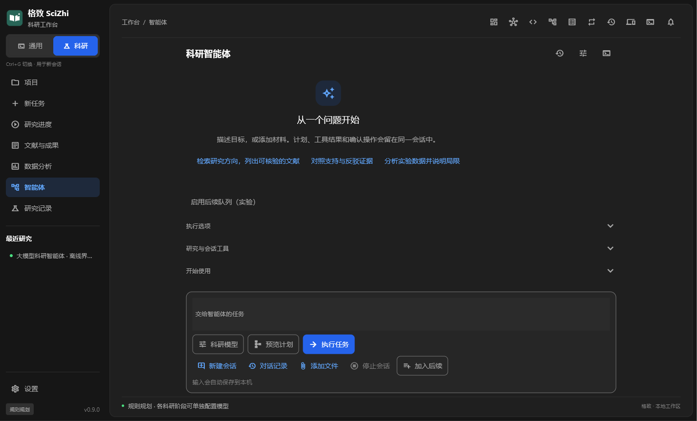
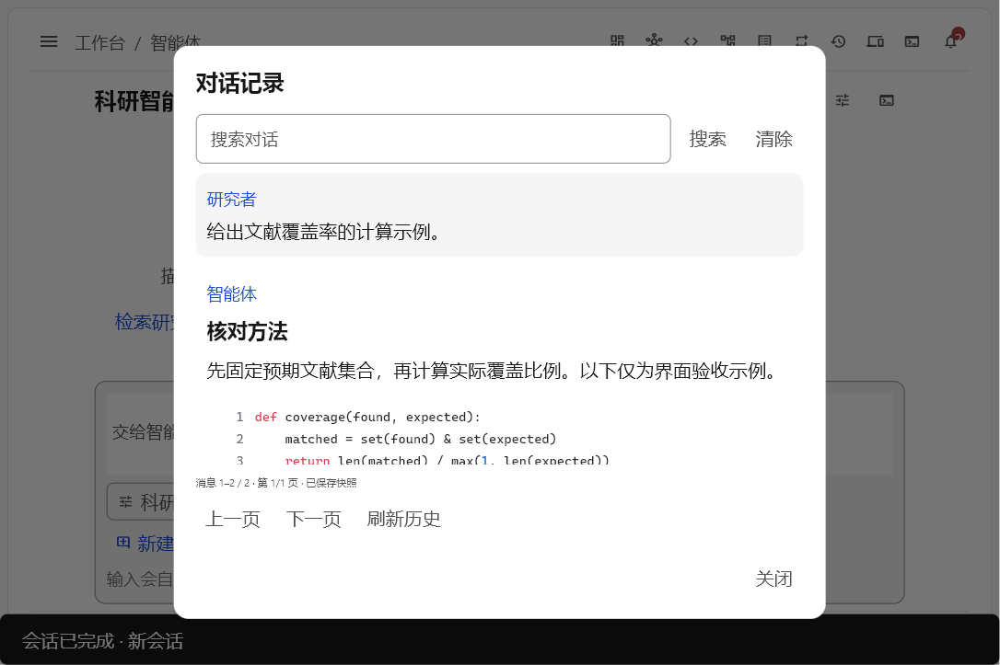
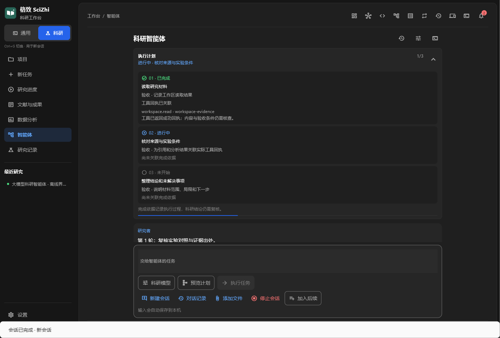
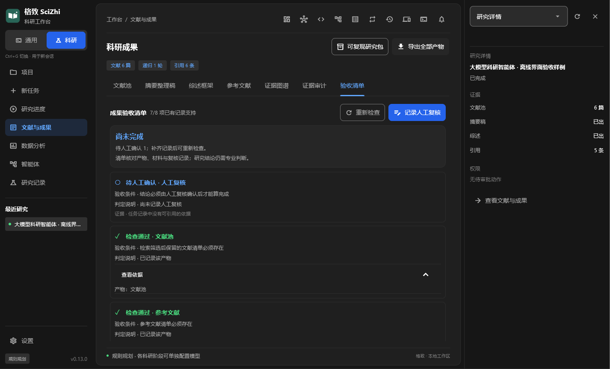
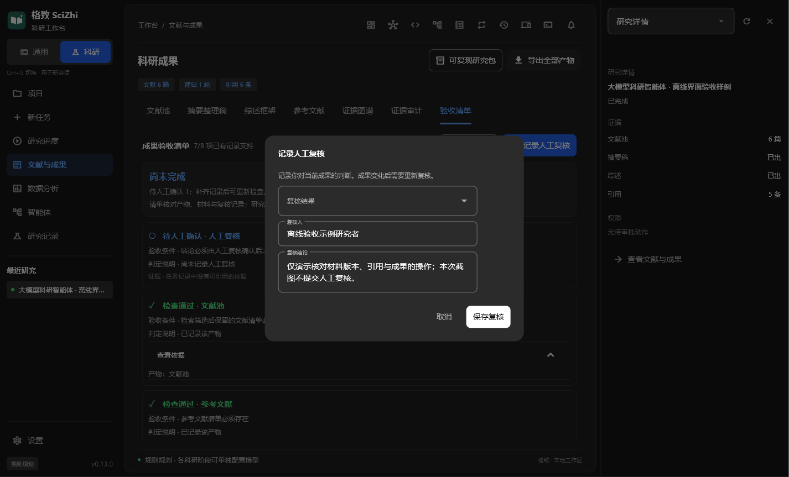

# 格致 SciZhi · 科研智能体工作台

[](https://github.com/abzzyyxcpht/gezhi-scizhi/actions/workflows/ci.yml)

SciZhi 把文献检索、证据整理、数据分析、代码执行和人工审查放在同一个本地工作台。围绕一个研究问题持续工作，保留过程、来源与产物，支持暂停、继续和复核。

当前源码版本 **0.13.0**。Flet 桌面端与 OpenTUI 终端端共用 Python 运行时、会话记录和设置。公开仓库持续更新，采用 [Apache-2.0](LICENSE) 许可。

0.13.0 将成果检查接通桌面与终端。复核绑定用户实际查看的成果版本，明确记录「通过」或「要求修改」；材料、摘要或引用变化后，旧复核需要重新确认。桌面提供重新检查、可展开依据和后台保存，终端使用 `/checks` 完成同一流程。详见 [0.13.0 发布说明](docs/release-notes-0.13.0.md)。

此前 0.12.0 加入思考参数的实际发送回执、成果检查清单、严格日志读取与工具执行入口加固。相关机制见[安全说明](docs/hardening-2026-10-20.md)和[成果检查接口](docs/outcome-checks-2026-10-22.md)。

此前 0.11.0 增加了会话执行计划与完成依据：模型可为复杂任务维护分步计划，执行项的完成状态需要关联当前回合的真实成功工具回执。未闭合的计划会获得一次预算内纠正机会，仍有缺项则明确标记未完成。桌面在对话上方显示进度，终端使用 `/progress` 查看。此前的数据源降级、会话恢复和代码复制改进见[智能体执行与科研流程改进](docs/agent-reliability-2026-10-15.md)。



原生桌面界面，使用隔离离线样例。下图展示会话中的代码预览，支持独立字号、行号、换行和保留原始缩进的直接复制。



## 开始使用

开发与 CI 使用 **Python 3.13、Node.js 24**。Windows PowerShell 在项目根目录执行：

```powershell
python -m venv .venv
$gezhiVenvScripts = (Resolve-Path .venv/Scripts).Path
$env:Path = "$gezhiVenvScripts;$env:Path"
python -m pip install -r requirements.txt
npm.cmd --prefix tui ci
python scripts/gezhi.py doctor
```

启动桌面：`python scripts/gezhi.py desktop`。启动终端：`npm.cmd --prefix tui start`。

macOS/Linux 使用 `source .venv/bin/activate` 激活虚拟环境，将 `npm.cmd` 改为 `npm`。这些平台仍需单独验证原生窗口、输入法和终端兼容性。

首次使用可运行离线演示，观察筛选、人工确认、断点续跑与产物导出：

```powershell
python scripts/gezhi.py demo "large language model agents" --out data/exports/demo
```

演示使用明确标注的合成文献，验证流程与追溯信息。真实检索需要联网，添加 `--online`；模型驱动的自主执行需要配置服务。

## 能做什么

| 工作 | 能力与产物 |
| --- | --- |
| 查找文献 | OpenAlex 与 Crossref 并行召回、DOI 去重、相关性排序、引用扩展；可配置向量检索和模型复核 |
| 整理证据 | 研究问题、假设、支持与反驳证据、原文摘录、局限和实验记录；保留出处与材料范围 |
| 组织综述 | 结构化抽取、摘要整理稿、综述提纲、缺证据章节检查与参考文献格式化 |
| 分析数据 | CSV/Excel 描述统计、异常值提示、相关性分析和图表生成 |
| 使用代码与工具 | 项目文件预览、文件读写、搜索、命令执行、实时输出与停止；副作用按权限策略审批 |
| 持续处理任务 | Plan / Agent / Review 模式、专项子任务、进度、暂停、续跑、会话恢复与用量统计 |
| 保存研究过程 | 研究包、来源清单、数据哈希、工具与环境记录；可选 Git 归档 |

检索评分用于排序，证据检查用于发现缺失和不一致；研究结论仍需要研究者核验。导出包保存已记录的信息，不自动补齐缺失实验条件。

## 桌面与终端体验

桌面以导航、工作区和检查器分区，长会话限制阅读宽度，输入区停靠底部。窄窗口使用导航抽屉，关闭抽屉保留会话与输入。终端保留常驻输入、历史回看、命令补全和键盘操作。

[共享外观定义](assets/ui-design.json) 管理主题、字体、代码显示与交互：

- 跟随系统、浅色和深色主题；界面字号 12–20px。
- 代码字号与桌面内置终端字号独立，代码配色、行号和长行显示可以调整。
- 紧凑/舒适密度、侧栏、检查器与动效开关；跨端同步时保留未提交的设置草稿。
- 中文系统字体回退与独立等宽字体；外部终端的字体和物理字号由终端软件设置。

桌面左下角「设置」和终端 `/config` 可调整偏好。具体行为与验证范围见 [界面说明](docs/ui-alignment-2026-10-15.md) 和 [设计规范](DESIGN.md)。

## 执行计划与完成依据

复杂多步任务可使用 `plan.read` / `plan.update` 记录步骤、完成标准和受阻原因。计划随会话日志保存，重启和上下文整理后仍可读取；新回合与回滚按实际日志隔离。旧会话不会自动扩大已冻结的工具范围。

- 桌面对话上方显示完成进度，展开可查看每步标准和回执；终端 `/progress [会话ID]` 支持只读查看。
- 执行类步骤关联当前回合成功业务工具的调用 ID；失败、未知、跨回合或仍在运行的回执不能冒充完成。解释类步骤明确显示为模型声明。
- 模型准备结束且计划未闭合时，运行时至多反馈一次并继续扣除原预算。再次未闭合则记录 `blocked / plan_incomplete`，保留步骤和原因供核查。
- 简单问答、离线规则流程和没有建立计划的旧会话沿用原有行为。计划记录不能授予文件、命令或外部工具的新权限。



工具回执表示已记录工具执行，不保证科研结论成立或产物通过全部验证。真实效果依赖所配置模型；本轮用隔离工具与模拟模型验证控制行为，没有虚构性能提升。

实现参考了成熟开源项目的完成检查和持久状态设计，但独立实现、不增加框架依赖。固定源码、许可证及版本差异见[上游研究记录](docs/research/2026-10-19-agent-harness-sources.md)，实施边界见[升级方案](docs/superpowers/plans/2026-10-19-execution-plan.md)。


## 成果验收清单

研究结论能否算"做完"，应该能被检查，而不是靠一句声明。任务记录里已存在的事实（产物键、材料哈希、研究包缺口、人工复核记录）会被组成一份确定性验收清单，每项只给出五种状态之一：`satisfied`（已核实）、`failed`（已核实但不成立）、`stale`（材料在记录后变化或丢失，原结论需复核）、`pending`（等待人工确认）、`unknown`（记录里根本没有这项事实）。

- 只有全部项目 `satisfied` 时整体结论才是 `all_satisfied`；有失败或过期项为 `needs_review`；还有待确认或未知项为 `incomplete`。"部分通过"不会被说成"完成"。
- 材料哈希与当前文件不一致时判定为 `stale` 而不是继续显示通过，并提示"原结论需要复核"。
- 人工复核必须显式选择「通过」或「要求修改」，记录复核人、说明、时间和成果版本。模型产物不能替代这项记录；旧格式复核记录需要重新确认。
- 桌面在「文献与成果 → 验收清单」查看清单。进入页面或点击「重新检查」会核对当前材料；展开条目可查看依据，读取失败时不开放复核。保存期间可继续使用界面，同一任务的复核不会并发覆盖。
- 终端先运行 `/checks <任务ID>`，用 `/checks <任务ID> --details` 展开依据。随后可提交刚查看版本的复核：`/checks review <任务ID> --decision approved --by "姓名" --note "核对说明"`。要求修改使用 `changes_requested`；未查看、版本变化或任务不匹配都会拒绝保存。该命令目前仅限本地引擎。
- 复核历史独立保存，使用原子写入和跨进程锁，保留最近 50 条。记录损坏时报告错误并保留原文件，不会用空数据覆盖。

实现与判定口径见[成果验收：确定性检查清单](docs/outcome-checks-2026-10-22.md)。



原生桌面截图使用隔离离线材料。示例有 7 项已有记录支持，人工复核仍待确认；弹窗不默认选择通过。



# 模型接入

在桌面「设置」的模型配置中填写服务地址、模型与凭据，保存后执行连接检测。支持 OpenAI 兼容接口，可配置默认模型、阶段模型与思考强度；服务端支持情况决定哪些参数实际生效。
### 思考强度的三段回执

「思考强度」是偏好设置，不是对模型推理质量的事实陈述。为避免把偏好画成效果，每次模型调用都会在 `data/logs/model_calls.jsonl` 留下一份三段回执，并在思考强度控件下方、`/usage` 与桥接 `usage` 回执中显示：

| 阶段 | 含义 | 来源 |
| --- | --- | --- |
| 请求 | 保存的档位，例如「深入（high）」 | 模型配置 |
| 实际发送 | 真正写进请求体的参数，如 `reasoning_effort=high`；或「未附带」「以 token 预算表达」 | 由 `build_request` 生成的真实请求体反查，不是按档位推断 |
| 供应商回报 | 供应商在 usage 里返回的推理 token 数 | 供应商响应 |

- 选择「供应商默认」时请求不附带思考参数，回执明写「未附带」；本地适配器拒绝某个档位时（例如 OpenAI 不接受 `max`）记为「未发送」并给出原因，不会静默降级成默认值。
- 供应商没有回报推理用量时显示「供应商未回报」，不会折叠成 `0`；供应商确实回报 `0` 时如实显示 `0 tokens`。两者在日志里是两个不同字段。
- 回执只记录档位、是否真的发送、发送的键名与回报的 token 数，不含提示词或密钥内容。
- 档位开关本身的滑块位移、最高档局部渐变与保存后的一次性确认亮边，都只表达「你选了什么／已保存」，不随档位提高而加速或循环。

实现见[安全加固与工程收口](docs/hardening-2026-10-20.md)，接口在 `src/reasoning_receipt.py`。


也可设置 `GEZHI_LLM_BASE_URL`、`GEZHI_LLM_MODEL` 和 `GEZHI_LLM_API_KEY` 环境变量，示例见 [.env.example](.env.example)。不要把实际密钥写入源码、截图或公开 Issue。使用云端模型时，发送的上下文会交给所配置的服务处理。

OpenAlex 基础检索可匿名访问；免费 API key 可扩大限额，游标翻页需要 key，详见 [OpenAlex 认证说明](https://help.openalex.org/api/authentication/)。如需认证，在启动应用前设置 `GEZHI_OPENALEX_API_KEY` 环境变量，检索与 `doctor` 探测会通过 `Authorization: Bearer` 请求头发送。项目不会自动加载 `.env` 文件；该凭据不写入查询参数、检索缓存或调用日志。

```powershell
python scripts/gezhi.py agent "整理课题的研究问题与验证步骤" --mode plan
python scripts/gezhi.py agent "检索研究课题并整理证据" --online
python scripts/gezhi.py agents
```

不加 `--online` 的命令行 Agent 使用离线路径。跨进程审批可使用 `approve <会话ID> <工具调用ID>` 或 `deny <会话ID> <工具调用ID>`。

## 常用入口

| 目的 | 桌面入口 | 终端命令 |
| --- | --- | --- |
| 自然语言任务 | 智能体 | `/agent`、`/plan`、`/review` |
| 会话管理 | 新建会话、对话记录、会话工具 | `/sessions`、`/history`、`/session-export` |
| 文献流程 | 新任务、研究进度、文献与成果 | `/new`、`/tasks`、`/pool`、`/digest`、`/outline`、`/cites` |
| 暂停与继续 | 研究进度、停止会话 | `/pause`、`/resume`、`/cancel` |
| 审批 | 待确认操作卡片 | `/approve`、`/deny` |
| 文件与项目 | 项目、添加文件 | `/project`、`/pdf` |
| 科研阅读 | 研究记录、证据图谱 | `/notebook`、`/graph`、`/read`、`/timeline` |
| 工作流与并行任务 | 科研工作流、任务进程、控制塔 | `/workflows`、`/processes`、`/tower`、`/swarm` |
| 研究包 | 项目交接、成果导出 | `/export`、`/package` |
| 模型与外观 | 设置 | `/models`、`/config`、`/theme` |
| 诊断与用量 | 系统自检、用量统计 | `/doctor`、`/usage` |

输入 `/help` 查看完整命令，`F1` 查看快捷键。`Ctrl+B` 开关侧栏，`Ctrl+G` 切换通用/科研用途。`Esc` 先关闭浮层或结束回看，再按上下文处理取消；双击 `Ctrl+C` 退出。

会话回滚只改变会话记录，已经写入的文件或外部操作不会因此撤销。队列、运行中补充和后台复核属于可选实验功能，默认关闭。

## 项目资料与扩展

- `GEZHI.md`：项目的研究约束与上下文，可用 `/init` 生成。
- `skills/<名称>/SKILL.md`：技能声明与说明，通过设置或 `/skills` 管理。
- `plugins/`：扩展命令与工作流动作，按项启用和重载。
- MCP：连接 stdio 或 Streamable HTTP 服务，在设置中配置工具、启用状态和权限。
- 局域网远控：复用本机运行时，支持手机控制台与远程 TUI；访问口令从主机生成。

模型服务、插件与 MCP 各自有权限和数据边界；仅启用自己信任的连接。

## 数据、权限与追溯

源码启动默认写入 `data/`，可用 `GEZHI_DATA_DIR` 指定独立目录。会话、草稿、上传材料、日志、缓存和模型设置保存在本地，不随源码提交。

工具权限包括只读、工作区写入和完全访问三个档位；具体动作再按 allow / ask / deny 策略决定。审批展示目标、影响与可逆性，子任务使用同一权限边界。取消可以停止后续执行与受管理的本地进程，但不能撤回已经发出的远程请求。

研究包保留产物、来源、工具、环境、数据哈希及缺失项；生成稿保留生成方式与来源标记。公开代码与自动化测试便于检查实现，不能代替安全审计或科研验证。

## 开发与验证

测试前将运行数据隔离到临时目录：

```powershell
$env:PYTHONUTF8 = "1"
$env:GEZHI_DATA_DIR = Join-Path $env:TEMP ("gezhi-check-" + [guid]::NewGuid().ToString("N"))
python -m pip install -r requirements-dev.txt
python scripts/run_ci.py
python scripts/lint_ui.py
python scripts/run_eval_set.py --out (Join-Path $env:GEZHI_DATA_DIR "eval_report.json")
```

`run_ci.py` 依次运行 Python 测试、Ruff 和 TUI 测试。原生桌面截图可用 `python scripts/capture_desktop.py` 生成，该工具使用自己的离线夹具目录。离线评测验证流程、产物与标记，不用于宣称真实检索准确率或节省时间。

源文件变更后同步刷新 `SOURCE_MANIFEST.json`，发布前运行 `python scripts/verify_public_source.py`，确认公开源码与审查清单一致。

## 目录与构建

```text
src/          Python 智能体、科研流程、服务与 Flet 桌面
tui/          OpenTUI 终端与 JSON Lines 桥客户端
assets/       品牌资源、远控页面与 UI 共享定义
workflows/    科研工作流模板
skills/       内置技能
plugins/      扩展命令与动作
examples/     脱敏示例与离线评测题目
tests/        Python 回归测试
scripts/      启动、构建、验证与发布工具
docs/         当前使用说明与设计记录
```

Windows 桌面构建需要 Flet 0.86.5 运行资源、PyInstaller 与 NSIS，版本取自 `src/version.py`。准备依赖后，在项目根目录运行：

```powershell
.\scripts\build_desktop.bat
```

构建脚本先生成桌面程序，再执行冻结程序自检并打包，本地输出为 `dist/SciZhi-Agent-Setup-0.13.0.exe`，同时生成 SHA-256 校验文件与自检报告。安装包使用带版本的快捷方式图标资源；卸载按安装文件清单删除，保留用户额外放入的文件，遇到路径被替换为链接时停止卸载。安装器支持在独立测试目录中验证安装与卸载；每次发行需核对安装文件、冻结自检、原生窗口及额外文件保留情况。

便携源码包工具为 `scripts/build_portable.py`。公开 Git 仓库不包含 `dist/` 安装器或第三方运行资源。

欢迎通过 [Issues](https://github.com/abzzyyxcpht/gezhi-scizhi/issues) 提供复现步骤，通过 Pull Request 提交改进。贡献规则见 [CONTRIBUTING.md](CONTRIBUTING.md)，安全问题见 [SECURITY.md](SECURITY.md)。第三方依赖保留各自许可。
